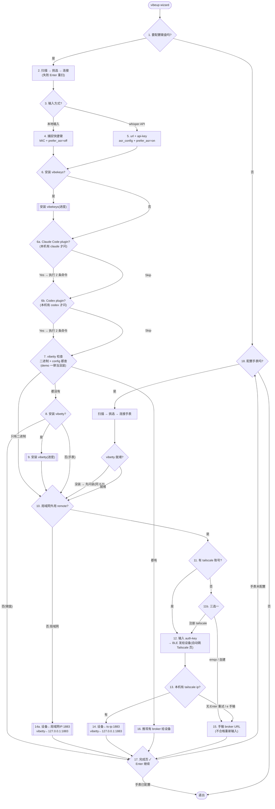

# vibeup wizard — 完整流程

约定:所有 BLE 写入都通过已连接的键盘会话;`prefer_asr` 指键盘的 `prefer_builtin_asr` 配置。

1. 要设置的是不是键盘?
   - 是 -> 2
   - 否 -> 18

2. 提示用户:打开键盘,进入 keyboard 模式。开始扫描键盘。
   扫描页提示:如果扫描不到,按一下键盘的 ACCEPT(重新广播)。
   连接上键盘 -> 3

3. 用什么输入方式?
   - 本地输入(typeless 类似) -> 4
   - whisper 兼容的 API 接口 -> 5

4. 你的输入法是什么快捷键?
   放一个输入框(keymap 风格),捕捉用户按下的按键组合,
   通过蓝牙设置给键盘的 MIC 键。
   并设置 prefer_asr = off(输入法快捷键优先) -> 6

5. 询问 whisper API 的 url 和 api-key。
   通过 ble 发送给键盘的 asr 配置。
   并设置 prefer_asr = on(内置 asr 优先) -> 6

6. 是否安装 vibekeys-app 来监控 claude code / codex 的工作状态?
   - 是 -> 安装 vibekeys 包,并安装 agent plugin(hook 配置就在 plugin 里):
     本机有 claude 就执行 `claude plugin marketplace add second-state/marketplace`
     + `claude plugin install vibekeys@second-state-tools`;
     有 codex 同理(`plugin add`)。 -> 7
   - 否 -> 7

7. 检查 vibetty 安装状态(二进制和 config 两者都查):
   - 二进制有 + config(`~/.vibetty/config.toml`)有 -> 16
   - 只有二进制、没 config -> 10
   - 都没有 -> 8

8. 要安装 vibetty 来支持远程控制吗?
   - 是 -> 9
   - 否 -> 17

9. 安装 vibetty(带进度显示) -> 10

10. 会在局域网外使用 remote 模式吗?
    - 是 -> 11
    - 否 -> 14a

11. 有 tailscale 账号吗?
    - 是 -> 12
    - 否 -> 11b

11b. 三选一:
    - 注册 tailscale 账号 -> 12
    - 注册 emqx -> 15
    - 自己部署代理 -> 15

12. 展示 tailscale auth-key 的获取页面(login.tailscale.com/admin/settings/keys),
    引导用户生成并复制 auth-key,输入进来。
    通过 ble 发送给键盘(设备写入后会自动跳到 Tailscale 页面) -> 13

13. 检查本机有没有 tailscale ip(`tailscale ip -4`)。
    - 没有 -> 提示用户安装 tailscale / 执行 `tailscale up`,提供"重试" -> 13
    - 有 -> 14

14. 获取本机 tailscale ip + 1883 端口,通过 ble 发送给键盘的 server-url;
    并给本机 vibetty 的 config 写 `mqtt://127.0.0.1:1883` -> 17

14a. 局域网模式:
    获取本机局域网 ip + 1883,通过 ble 发送给键盘的 server-url;
    并给本机 vibetty 的 config 写 `mqtt://127.0.0.1:1883` -> 17

15. 输入 broker 地址(emqx 或自建代理)。
    校验:scheme ∈ {mqtt, mqtts, ws, wss} 且 host 非空;
    - 不符合 -> 提示不符合要求,重新输入 -> 15
    - 符合 -> 通过 ble 发送给键盘的 server-url,并写入 vibetty 的 config -> 17

16. 读取 vibetty config 里的 broker url,通过 ble 设置给键盘的 server-url -> 17

17. 配置完成确认页:逐条 ✓ 列出本次已写入的配置(BLE、安装、文件)。
    Enter 继续:
    - 手表未配置 -> 18
    - 手表已配置 -> 22

18. 询问是否要配置手表?
    - 是 -> 19
    - 否 -> 22

19. 提示用户:打开手表,进入配网模式(Setting → Enable BLE)。
    开始扫描手表,连接 -> 20

20. 手表只有 remote 模式(没有本地输入/ASR/键位这些步骤)。
    会在局域网外使用 remote 吗?
    (若本机尚未安装 vibetty,先引导安装,同 8-9)
    - 是 -> 21
    - 否 -> 21a

21. broker 选型与键盘的 11/11b -> 12 -> 13 -> 14/15 完全相同
    (有 tailscale 账号 -> auth-key 写给手表、`tailscale ip -4` 检查、
     server-url = tailscale-ip:1883;emqx/自建 -> 输入地址、校验后写入)。
    唯一区别:server-url 通过 ble 写给手表,而不是键盘 -> 22

21a. 局域网模式:本机局域网 ip + 1883 通过 ble 写给手表的 server-url -> 22

22. 全部结束。

## 流程图

双线框 `[[...]]` = 有实际写入(BLE/安装)的步骤;`{...}` = 询问/分支。
